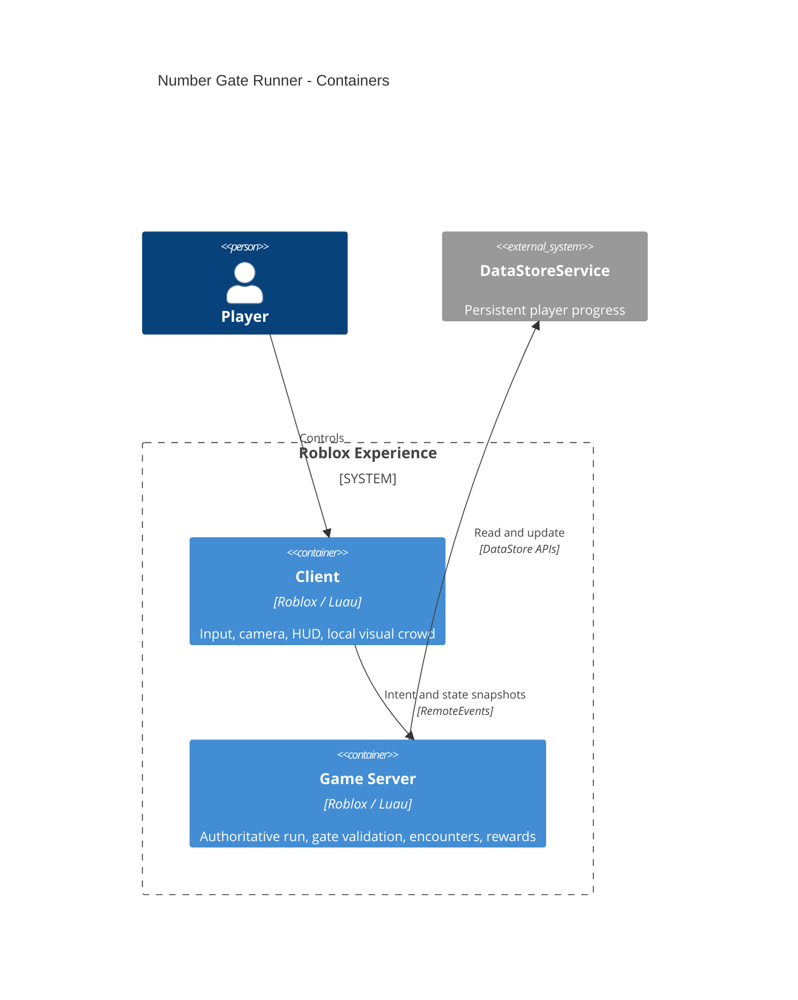
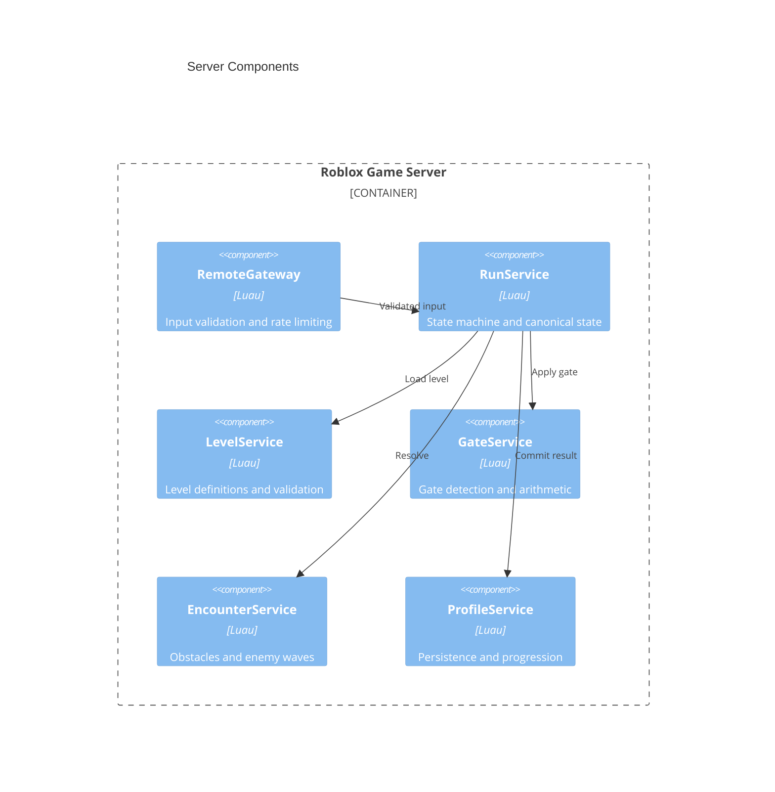
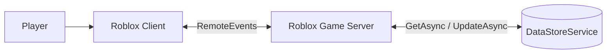

# Number Gate Runner — Roblox

**Status:** architecture and repo initialization specification (October 2026). No gameplay implemented yet.

A Roblox 3D arcade game built around steering a growing group through arithmetic gates. Original graphics, names and levels; no advertising, base-building or pay-to-win. Roblox-hosted experience, **not** an independently deployable PWA.

## Scope and milestones

| Milestone | Deliverable | Estimate (1 experienced developer, coding assistance) |
|---|---|---|
| Bootstrap | Git, Rojo, Studio sync, lint and test skeleton | 2–3 days |
| Vertical slice | Steering, camera, one level, +/−/× gates, group rendering | 5–10 days |
| MVP | 10 levels, obstacles, encounters, UI, saves, tests | 2–4 additional weeks |
| Release | 30–50 levels, mobile profiling, balancing, sound, polish | 3–6 additional weeks |

Estimates are planning assumptions, not guaranteed delivery dates. No multiplayer competition in MVP; each player's run is independent, although Roblox servers may host multiple players.

## C4 Level 1 — Context


## C4 Level 2 — Containers



## C4 Level 3 — Server components



Fallback for Mermaid renderers without C4 support:



## Stack

| Tool | Role |
|---|---|
| Roblox Studio | World editing, playtests, publishing |
| Luau `--!strict` | Game code and shared domain logic |
| VS Code | Editing and agent workflows |
| Rojo | Git-tracked filesystem to Studio synchronization |
| StyLua / Selene | Formatting and linting |
| TestEZ or compatible runner | Luau unit tests (select and pin at bootstrap) |
| GitLab CI or GitHub Actions | Checks and reproducible build |
| Wally | Optional dependencies; avoid initially |

## Target repository layout

```text
.
├── README.md
├── default.project.json
├── .gitignore
├── .stylua.toml
├── selene.toml
├── src/
│   ├── client/
│   │   ├── init.client.luau
│   │   ├── controllers/
│   │   │   ├── InputController.luau
│   │   │   ├── CameraController.luau
│   │   │   └── FormationRenderer.luau
│   │   └── ui/HudController.luau
│   ├── server/
│   │   ├── init.server.luau
│   │   └── services/
│   │       ├── RemoteGateway.luau
│   │       ├── RunService.luau
│   │       ├── LevelService.luau
│   │       ├── GateService.luau
│   │       ├── EncounterService.luau
│   │       └── ProfileService.luau
│   └── shared/
│       ├── config/{GameConfig,Levels}.luau
│       ├── domain/{GateMath,RunState}.luau
│       └── net/Protocol.luau
├── tests/
├── assets/
└── .gitlab-ci.yml
```

This is the intended architecture; only README and initial Rojo mapping are provided in this package. Level geometry and assets authored in Studio need their own versioning/ownership plan. Rojo synchronization alone is not a complete backup of the Studio place.

## Gameplay domain rules

- **State machine:** `Lobby -> Loading -> Running -> Completed|Failed -> Results -> Lobby`.
- **Movement:** automatic forward movement, player-controlled lateral position; server validates bounded steering and plausible progress.
- **Gate:** unique ID, `add|subtract|multiply`, integer operand; first validated crossing only. Group size clamped to `0..MAX_GROUP_SIZE`; zero ends the run.
- **Encounter:** obstacles/enemies reduce group count by deterministic, testable rules; server resolves outcomes.
- **Level:** declarative ID, length, gate/obstacle positions, encounters and completion conditions. Validate all definitions on load.
- **Rewards:** awarded once by server on legitimate completion. No client-controlled points, group count or level unlocks.
- **Visual crowd:** client renders pooled lightweight models/meshes. Logical count may be greater than visible count; avoid per-unit Humanoids and replicated physics.

## Network protocol (proposed)

| Event | Direction | Payload | Validation |
|---|---|---|---|
| StartRun | C→S | levelId | Unlocked, valid state, cooldown |
| Steer | C→S | axis, sequence | Finite `-1..1`, sequence, rate limit |
| RunSnapshot | S→C | runId, progress, laneX, groupCount, state | Server-generated |
| RunEnded | S→C | result, earnedPoints | Server-generated |

Never expose client-callable `SetGroupCount`, `AwardPoints` or `CompleteLevel`. Validate all remotes by type, structure, context, rate and game state. Client effects are cosmetic, not authoritative.

## Persistence

Store a versioned profile under `User_<UserId>` in a small fixed set of DataStores:

```lua
{
    schemaVersion = 1,
    highestUnlockedLevel = 1,
    bestScores = {},
    earnedPoints = 0,
    unlockedCosmetics = {},
    settings = { soundEnabled = true },
}
```

Cache in memory during play, save at important checkpoints, player departure and server shutdown. Use `UpdateAsync` for concurrent modifications, bounded retries/backoff and session protection. Test migrations and persistence failures. Do not connect development Studio tests to production data.

## Performance and accessibility targets

- Target 60 FPS on mid-range devices, acceptable 30 FPS on representative low-end supported phones; measure, do not assume.
- Start with 100–200 **visible** crowd units as a hypothesis; profile and tune. Do not equate visible units with logical count.
- Use pooled visual objects, simplified animations, limited effects, bounded RemoteEvent rates.
- Test real mobile hardware, touch input, screen safe areas and UI scaling.
- Gates must show mathematical symbols, not color alone; adjustable audio and readable labels.
- Use Roblox MicroProfiler for frame-time and network analysis.

## Testing and quality gates

**Unit:** gate arithmetic, negative/zero/overflow/clamp, repeated crossings, run transitions, level schema, reward calculation.

**Integration:** invalid/spammed remotes, reconnect, concurrent sessions, level locks, DataStore failures, server shutdown, no duplicate rewards.

**Playtests:** 10 levels, touch and keyboard, 30/60 FPS device targets, UI legibility, retry and progression.

**CI:** `stylua --check src tests`, `selene src tests`, automated Luau tests once runner is installed, `rojo build default.project.json -o build.rbxlx`. Publishing must be a separately authorized staging/release operation. Pin tool versions after choosing a toolchain.

## Local setup

1. Install Roblox Studio, Rojo CLI + Studio plugin, VS Code, StyLua and Selene.
2. Clone repo, run `rojo serve default.project.json`.
3. Open a development-only Roblox Studio place; connect Rojo plugin.
4. Add source modules following the target layout; test using Studio Play and multi-client modes.
5. Run lint/format/test/build checks. Keep staging separate from production.

## Backlog (implementation order)

1. Toolchain and repository skeleton; Rojo sync and strict Luau.
2. Pure `GateMath` and tests.
3. Level schema, validation and first authored level.
4. Server run state machine and remote validation.
5. Steering, camera and formation renderer.
6. Gate collision/crossing, encounter rules, UI.
7. Persistence, results, retries and migration tests.
8. Nine more levels, balancing and mobile performance profiling.

**Vertical-slice gate:** Verify fun factor and mobile frame time before investing in 50 levels.

## Coding agent conventions

- `--!strict` where possible; no implicit globals, avoid `any`.
- Keep pure game rules separate from Roblox service adapters.
- Treat all client data as untrusted; never trust client score/rewards/collisions.
- Avoid per-frame remotes and per-unit replicated physics.
- Add tests for every change to arithmetic, state transitions or rewards.
- No ads, purchases, paid mechanics, third-party trackers or unauthorized game assets.
- Keep changes reviewable; document performance and dependency decisions.

## Architecture decisions

- ADR-001: Roblox-native experience, not a standalone PWA.
- ADR-002: Server-authoritative run and progression state.
- ADR-003: Lightweight local crowd rendering, not one networked Humanoid per unit.
- ADR-004: Git-first Rojo + Luau modules; Studio-owned 3D scenes.
- ADR-005: No monetization or custom backend for MVP.

## Definition of done (MVP)

10 completable levels on PC/mobile; correct one-time arithmetic gate effects; server-validated progress; saved unlocks; passing automated checks; measured mobile performance; original art and audio; no in-game ads or purchases.

## Sources

- [Roblox: client/server](https://create.roblox.com/docs/projects/client-server)
- [Roblox: data model](https://create.roblox.com/docs/projects/data-model)
- [Roblox: securing client/server](https://create.roblox.com/docs/scripting/security/client-server-boundary)
- [Roblox: DataStore best practices](https://create.roblox.com/docs/cloud-services/data-stores/best-practices)
- [Roblox: performance](https://create.roblox.com/docs/performance-optimization)
- [Roblox: MicroProfiler](https://create.roblox.com/docs/performance-optimization/microprofiler)
- [Roblox: IP guidelines](https://create.roblox.com/docs/production/publishing/ip-guidelines)
- [Rojo project format](https://github.com/rojo-rbx/rojo.space/blob/master/docs/project-format.md)
