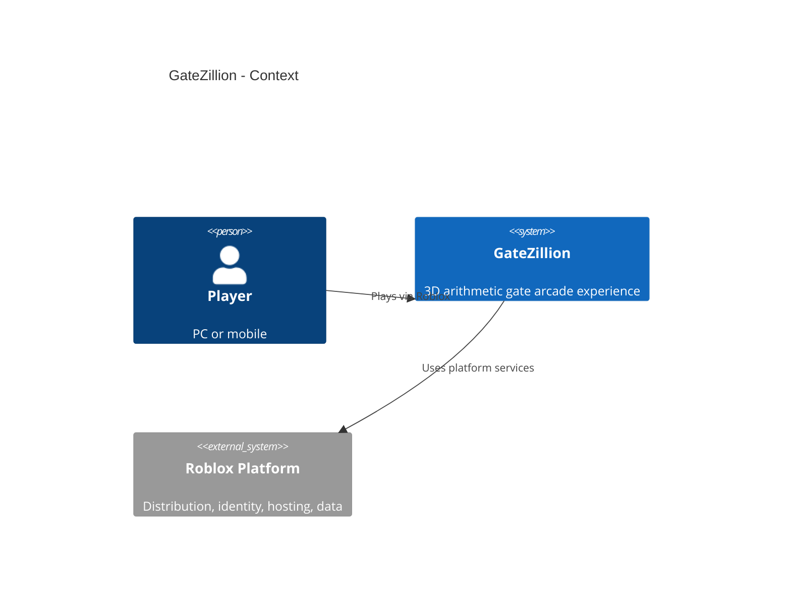
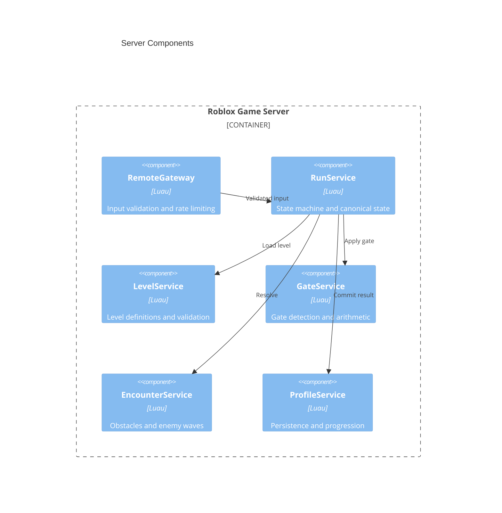
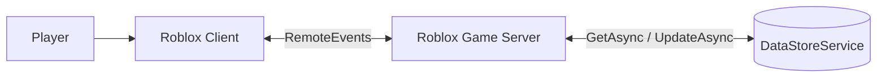

# GateZillion — Roblox

**Status:** first playable MVP (October 2026). Ten levels, server-authoritative runs, persistence, HUD and automated checks are implemented. Not yet playtested in Roblox Studio or on mobile hardware; see [MVP status](#mvp-status).

A Roblox 3D arcade game built around steering a growing group through arithmetic gates. Original graphics, names and levels; no advertising, base-building or pay-to-win. Roblox-hosted experience, **not** an independently deployable PWA.

## Scope and milestones

| Milestone | Deliverable | Estimate (1 experienced developer, coding assistance) |
|---|---|---|
| Bootstrap | Git, Rojo, Studio sync, lint and test skeleton | 2–3 days |
| Vertical slice | Steering, camera, one level, +/−/× gates, group rendering | 5–10 days |
| MVP | 10 levels, obstacles, encounters, UI, saves, tests | 2–4 additional weeks |
| Release | 30–50 levels, mobile profiling, balancing, sound, polish | 3–6 additional weeks |

Estimates are planning assumptions, not guaranteed delivery dates. No multiplayer competition in MVP; each player's run is independent, although Roblox servers may host multiple players.

## Quick start

```bash
rokit install                 # pinned tools from rokit.toml (or scripts/install-tools.sh on Linux CI)
scripts/check.sh              # format, lint, build, strict type check, tests
rojo serve default.project.json
```

Open a development-only place in Roblox Studio, connect the Rojo plugin and press Play. Studio sessions use an in-memory profile store (`GameConfig.USE_DATASTORE_IN_STUDIO = false`). `rojo build default.project.json -o build/GateZillion.rbxl` produces a standalone place file; CI uploads it as an artifact.

**How to play:** pick an unlocked level, steer with A/D, the arrow keys, a gamepad stick or by dragging left/right on touch screens. The group runs forward automatically. Gates change the group size (`+N`, `-N`, `×N`), orange hazards remove units in their lane, red enemy squads span the whole track and trade one-for-one. Reach the finish with at least one unit to clear the level, earn points and unlock the next one.

## C4 Level 1 — Context



## C4 Level 2 — Containers


## C4 Level 3 — Server components



Fallback for Mermaid renderers without C4 support:



## Stack

| Tool | Role |
|---|---|
| Roblox Studio | World editing, playtests, publishing |
| Luau `--!strict` | Game code and shared domain logic |
| VS Code | Editing and agent workflows |
| Rojo | Git-tracked filesystem to Studio synchronization |
| StyLua / Selene | Formatting and linting |
| Lune + TestEZ-style runner | Headless Luau unit and integration tests (`tests/runner.luau`) |
| luau-lsp | Strict type checking against the Roblox API definitions |
| GitHub Actions | Checks and reproducible build (`.github/workflows/ci.yml`) |
| Rokit | Pinned tool versions (`rokit.toml`) |
| Wally | Optional dependencies; not used |

## Repository layout

```text
.
├── default.project.json         # Rojo mapping (ReplicatedStorage.Shared, ServerScriptService.Server, StarterPlayerScripts.Client)
├── rokit.toml                   # pinned toolchain
├── .stylua.toml, selene.toml, testez.yml, .luaurc
├── scripts/
│   ├── install-tools.sh         # pinned Linux binaries for CI (.tools/bin)
│   ├── check.sh                 # all quality gates
│   └── test.sh                  # build + tests only
├── .github/workflows/ci.yml
├── src/
│   ├── client/
│   │   ├── init.client.luau     # composition root
│   │   ├── controllers/
│   │   │   ├── InputController.luau     # keyboard, gamepad, touch drag -> axis
│   │   │   ├── CameraController.luau    # lobby overview, chase camera
│   │   │   ├── FormationRenderer.luau   # pooled crowd parts, BulkMoveTo
│   │   │   ├── TrackRenderer.luau       # local level geometry from level data
│   │   │   └── RunPresenter.luau        # snapshot mirror, steering prediction
│   │   └── ui/HudController.luau        # level select, run HUD, results
│   ├── server/
│   │   ├── init.server.luau     # composition root
│   │   └── services/
│   │       ├── RemoteGateway.luau       # validation, rate limits, remotes
│   │       ├── RunService.luau          # authoritative runs, fixed-step simulation
│   │       ├── LevelService.luau        # validation, completability, lookup
│   │       ├── GateService.luau         # gate crossing detection
│   │       ├── EncounterService.luau    # obstacle/enemy detection
│   │       ├── ProfileService.luau      # cache, session lock, saves, rewards
│   │       └── ProfileStore.luau        # DataStore adapter, in-memory store
│   └── shared/
│       ├── config/{GameConfig,Levels}.luau
│       ├── domain/{GateMath,EncounterRules,Hits,RunState,Rewards,ProfileData,Types}.luau
│       ├── net/Protocol.luau
│       └── util/RateLimiter.luau
└── tests/
    ├── runner.luau              # Lune runner, TestEZ-style API
    ├── shared/ server/ client/  # *.spec.luau
```

`assets/` is not needed yet: all geometry is generated from level data (see ADR-006).

## Gameplay domain rules

- **State machine:** `Lobby -> Loading -> Running -> Completed|Failed -> Results -> Lobby`.
- **Movement:** automatic forward movement, player-controlled lateral position; server validates bounded steering and plausible progress.
- **Gate:** unique ID, `add|subtract|multiply`, integer operand; first validated crossing only. Group size clamped to `0..MAX_GROUP_SIZE`; zero ends the run.
- **Crossing:** an element at distance `z` is hit when the server step travels over `z` and the interpolated lateral position lies in its lane. Lanes are half-open `[xMin, xMax)`, so neighbouring lanes never overlap. Within a row: gates, then obstacles, then enemies.
- **Encounter:** obstacles remove a fixed number of units in their lane; enemy squads span the full width and trade one-for-one. Server resolves outcomes.
- **Level:** declarative ID, length, start count, rows of gates/hazards/enemies and a minimum finish count. All definitions are validated on server start: ranges, unique IDs, lane overlaps, row spacing (enough to steer across the track between rows) and completability. Because every rule is monotonic in the group size, the greedy per-row maximum is the best possible finish count; it is used for validation and star ratings, and a test drives every level to exactly that value through the real simulation.
- **Rewards:** awarded once by server on legitimate completion. No client-controlled points, group count or level unlocks.
- **Visual crowd:** client renders pooled lightweight models/meshes. Logical count may be greater than visible count; avoid per-unit Humanoids and replicated physics.

## Network protocol

| Event | Direction | Payload | Validation |
|---|---|---|---|
| StartRun | C→S | levelId | Integer in range, unlocked, Lobby/Results state, cooldown, rate limit |
| Steer | C→S | axis, sequence | Finite `-1..1`, strictly increasing integer sequence, rate limit |
| ClientReady | C→S | — | Rate limit; server answers with ProfileUpdated once loaded |
| RunSnapshot | S→C | runId, levelId, phase, phaseTime, progress, laneX, groupCount | Server-generated, 10 Hz while active and on phase changes |
| RunEvent | S→C | runId, kind, id, before, after | Server-generated per gate/obstacle/enemy hit |
| RunEnded | S→C | result, reason, finalCount, earnedPoints, stars, bestScore, newBest, unlockedLevel | Server-generated |
| ProfileUpdated | S→C | highestUnlockedLevel, earnedPoints, bestScores, soundEnabled | Server-generated |

Every remote checks argument count, types and ranges before game state. The client predicts only its own lateral position for responsive steering and reconciles with snapshots once input is idle; progress, counts and outcomes always come from the server.

Never expose client-callable `SetGroupCount`, `AwardPoints` or `CompleteLevel`. Validate all remotes by type, structure, context, rate and game state. Client effects are cosmetic, not authoritative.

## Persistence

Store a versioned profile under `User_<UserId>` in a small fixed set of DataStores:

```lua
{
    schemaVersion = 1,
    highestUnlockedLevel = 1,
    bestScores = {},
    earnedPoints = 0,
    unlockedCosmetics = {},
    settings = { soundEnabled = true },
}
```

The stored record wraps the profile with a session lock: `{ profile = <above>, session = { jobId, lockedAt } }`. `bestScores` uses string keys (`"1"`, `"2"`, …) so it always serialises as a JSON object.

Cache in memory during play, save at important checkpoints, player departure and server shutdown. Use `UpdateAsync` for concurrent modifications, bounded retries/backoff and session protection. Test migrations and persistence failures. Do not connect development Studio tests to production data.

Implemented behaviour: load retries DataStore errors and foreign locks with exponential backoff and takes over the lock on the final attempt (or immediately when it is older than `SESSION_LOCK_TIMEOUT`); a server that lost its session stops writing. Corrupt records or profiles from a newer schema are refused and never overwritten (the player is asked to rejoin). Saves happen after every completed run, every `AUTOSAVE_INTERVAL` seconds, on leave (releasing the lock) and in `BindToClose`. Migrations live in `ProfileData.MIGRATIONS`. Use a separate experience (and therefore separate DataStores) for staging.

## Performance and accessibility targets

- Target 60 FPS on mid-range devices, acceptable 30 FPS on representative low-end supported phones; measure, do not assume.
- Start with 100–200 **visible** crowd units as a hypothesis; profile and tune. Do not equate visible units with logical count.
- Use pooled visual objects, simplified animations, limited effects, bounded RemoteEvent rates.
- Test real mobile hardware, touch input, screen safe areas and UI scaling.
- Gates must show mathematical symbols, not color alone; adjustable audio and readable labels.
- Use Roblox MicroProfiler for frame-time and network analysis.

## Testing and quality gates

**Unit:** gate arithmetic, negative/zero/overflow/clamp, repeated crossings, run transitions, level schema, reward calculation.

**Integration:** invalid/spammed remotes, reconnect, concurrent sessions, level locks, DataStore failures, server shutdown, no duplicate rewards.

**Playtests:** 10 levels, touch and keyboard, 30/60 FPS device targets, UI legibility, retry and progression.

**CI:** `stylua --check src tests`, `selene src tests`, `rojo build`, strict type check with `luau-lsp analyze` against the Roblox API definitions, and the test suite. Publishing must be a separately authorized staging/release operation. Tool versions are pinned in `rokit.toml` and `scripts/install-tools.sh`.

**Test runner:** `tests/runner.luau` runs under [Lune](https://github.com/lune-org/lune). It loads the place built by Rojo and resolves `require(script.Parent.X)` against the real instance tree, so modules are tested exactly as Roblox loads them. Specs use the TestEZ style (`describe`/`it`/`expect(...).to.equal`), keeping the option to run them with TestEZ inside Studio later. Server services take their dependencies (store, clock, gateway, profiles) as parameters, so integration tests run the real simulation with fakes. Current suite: 93 tests covering gate arithmetic, run transitions, level validation and completability, remote validation and spam, rewards without duplicates, session locks, DataStore failures, migrations, shutdown and client prediction.

## Local setup

1. Install Roblox Studio, the Rojo Studio plugin, VS Code and [Rokit](https://github.com/rojo-rbx/rokit); run `rokit install` for Rojo, StyLua, Selene, Lune and luau-lsp.
2. Clone repo, run `rojo serve default.project.json`.
3. Open a development-only Roblox Studio place; connect Rojo plugin.
4. Test using Studio Play and multi-client modes (Test → Clients and Servers).
5. Run `scripts/check.sh` before pushing. Keep staging separate from production.

## Backlog (implementation order)

1. ~~Toolchain and repository skeleton; Rojo sync and strict Luau.~~
2. ~~Pure `GateMath` and tests.~~
3. ~~Level schema, validation and first authored level.~~
4. ~~Server run state machine and remote validation.~~
5. ~~Steering, camera and formation renderer.~~
6. ~~Gate collision/crossing, encounter rules, UI.~~
7. ~~Persistence, results, retries and migration tests.~~
8. ~~Nine more levels~~; balancing and mobile performance profiling (open, needs playtests).

**Vertical-slice gate:** Verify fun factor and mobile frame time before investing in 50 levels.

## Coding agent conventions

- `--!strict` where possible; no implicit globals, avoid `any`.
- Keep pure game rules separate from Roblox service adapters.
- Treat all client data as untrusted; never trust client score/rewards/collisions.
- Avoid per-frame remotes and per-unit replicated physics.
- Add tests for every change to arithmetic, state transitions or rewards.
- No ads, purchases, paid mechanics, third-party trackers or unauthorized game assets.
- Keep changes reviewable; document performance and dependency decisions.

## Architecture decisions

- ADR-001: Roblox-native experience, not a standalone PWA.
- ADR-002: Server-authoritative run and progression state.
- ADR-003: Lightweight local crowd rendering, not one networked Humanoid per unit.
- ADR-004: Git-first Rojo + Luau modules; Studio-owned 3D scenes.
- ADR-005: No monetization or custom backend for MVP.
- ADR-006: Level geometry is generated on each client from the shared level definitions instead of being authored in Studio. Keeps levels reviewable in Git, avoids replicating geometry and lets every player see their own run. Studio-authored scenery can be layered on later without touching game rules.
- ADR-007: Tests run headless with Lune against the Rojo-built place; GitHub Actions instead of GitLab CI because the repository is hosted on GitHub.

## Definition of done (MVP)

10 completable levels on PC/mobile; correct one-time arithmetic gate effects; server-validated progress; saved unlocks; passing automated checks; measured mobile performance; original art and audio; no in-game ads or purchases.

## MVP status

| Definition of done | State |
|---|---|
| 10 completable levels | Done; validated on start and driven to their best result in tests |
| Correct one-time arithmetic gate effects | Done; unit and integration tests |
| Server-validated progress | Done; server simulates movement, client sends only steering intent |
| Saved unlocks | Done; DataStore with session lock, retries, migrations |
| Passing automated checks | Done locally (format, type check, build, 93 tests); Selene runs in CI |
| PC/mobile playable | Code complete for keyboard, gamepad and touch; **not yet playtested in Studio or on devices** |
| Measured mobile performance | Open: profile with MicroProfiler on real low-end phones |
| Original art and audio | Open: art is procedural primitives; no audio yet (needs uploaded original assets) |
| No in-game ads or purchases | Done |

Best possible finish counts (perfect steering): 66, 46, 55, 51, 56, 75, 170, 380, 480, 2000 for levels 1–10. Balancing beyond that needs playtests.

## Sources

- [Roblox: client/server](https://create.roblox.com/docs/projects/client-server)
- [Roblox: data model](https://create.roblox.com/docs/projects/data-model)
- [Roblox: securing client/server](https://create.roblox.com/docs/scripting/security/client-server-boundary)
- [Roblox: DataStore best practices](https://create.roblox.com/docs/cloud-services/data-stores/best-practices)
- [Roblox: performance](https://create.roblox.com/docs/performance-optimization)
- [Roblox: MicroProfiler](https://create.roblox.com/docs/performance-optimization/microprofiler)
- [Roblox: IP guidelines](https://create.roblox.com/docs/production/publishing/ip-guidelines)
- [Rojo project format](https://github.com/rojo-rbx/rojo.space/blob/master/docs/project-format.md)
